# Discus: a scalable Redis-compatible cache

Status: living design. This document replaces four earlier specs: the base design (2026-11-07), the
Authelia session store (2026-11-09), the overload control lane (2026-11-10), and slot-aware routing
(2026-11-11).

Code comments cite this document as "spec section N". Sections 1 to 18 keep the numbers of the base
design, so those references stay valid. Section 19 holds primary-read keys and `RENAME`.

## 1. Summary

Discus is a horizontally scalable, Redis-compatible cache written in Rust. Every node is identical.
It stores data, routes requests, gossips membership, and replicates. There is no proxy tier, no
Sentinel, and no external consensus service.

Discus serves two kinds of client at the same time:

- An ordinary Redis client connects through an L4 load balancer to any node. That node forwards
  each command to the node that serves the key. The client never sees the topology.
- A Redis Cluster client reads the slot map from any node and sends each command straight to the
  node that serves its key. A misrouted command gets `-MOVED`.

Discus is a cache, not a database. A restart can lose data. The design trades durability for
horizontal scale, predictable p99 latency, and simple operations.

The main choices:

- Placement maps each key to a Redis Cluster slot. Weighted rendezvous (HRW) hashing over the
  gossip member list picks the owners of each group of 8 slots. The replication factor is 3.
- Writes go to the primary and replicate asynchronously. Conflicts resolve by HLC last-write-wins.
- An opt-in `cnt:` keyspace gives linearizable counters. It uses leader-follower groups below three
  nodes and Raft groups from three nodes.
- Node-to-node traffic is QUIC with mTLS and FlatBuffers messages. Client traffic is RESP2/RESP3
  over TCP.
- Membership, gossip, and the admin server run on their own thread, so an overloaded node stays a
  healthy member.
- Clients authenticate with OAuth 2.0 bearer tokens, mTLS, or a shared token. Kubernetes workloads
  can use their service account token.
- Metrics and traces export through OpenTelemetry over OTLP/gRPC.

## 2. Scope

Goals:

- RESP2 and RESP3 compatibility for the common cache command set. `redis-cli`, `redis-rs`,
  `redis-py`, and `ioredis` work unmodified.
- Any node accepts any key. Clients can stay topology-unaware.
- Redis Cluster clients can route directly to the owner of a key and skip the forward.
- Adding or removing a node moves about its fair share of keys. A node that gains keys receives a
  handoff and does not start cold.
- A node loss causes no read errors within the replication factor. Idempotent writes are held and
  retried against the new primary. Other writes can see a brief `-TRYAGAIN`.
- Failure detection and failover are automatic. An overloaded node does not blame its peers for
  its own slowness.
- Best-effort read-your-writes on one connection.
- Rolling restarts and rolling upgrades between builds with the same wire format (§13.3).
- Metrics, traces, health probes, and graceful drain.

Non-goals:

- Durability. There is no AOF, no RDB, and no warm-restart snapshot.
- `MULTI`/`EXEC`, `WATCH`, Lua, functions, Pub/Sub, keyspace notifications, streams, and blocking
  commands.
- Redis Cluster slot management (`CLUSTER ADDSLOTS`, `-ASK`, and similar) and the Sentinel
  protocol. Discus places slots by itself.
- Cross-datacenter replication and multi-zone placement. Placement keeps a hook for zone
  constraints.
- Strong consistency for normal keys.
- Multi-tenancy and per-key or per-command ACLs. Authorization is scope-based.
- Issuing OAuth 2.0 tokens. Discus is a resource server only.
- RESP over QUIC.

Hard rules:

- Gossip carries membership only, never key locations.
- A client that does not want to know the topology never needs to.
- Each key has one primary per epoch, and only the primary applies writes to it.
- Unsupported commands return a clear error. Discus never claims compatibility it lacks.
- A single node failure must not corrupt placement or empty the cache.
- Every staleness and loss window is documented (§12.1).
- Only permissive licenses on the critical path. No BSL or SSPL.

## 3. Terms

| Term | Meaning |
| --- | --- |
| `NodeId` | Random 128-bit ID that a node generates at process start. A restarted pod is a new node. |
| Epoch | A numbered snapshot of the member list. Placement changes only through a new epoch. |
| Slot | The Redis Cluster slot of a key: CRC16 of the key or its hash tag, modulo 16384. |
| Range | A group of 8 consecutive slots. HRW places ranges, not keys. |
| Owner set | The top `min(RF, N)` `NORMAL` members of a range by HRW score. The first owner is the primary. The others are secondaries. |
| Entry node | The node that a client connection lands on. |
| Forward listener | The client port (`--listen`) that forwards commands for other nodes' keys. |
| Redirect listener | The client port (`--redirect-listen`) that answers `-MOVED` for other nodes' keys. |
| Handoff | Streaming entries to a node that gained ownership of them. |
| Hint | A write that the primary holds for an unreachable secondary. |
| Write set | The recently written keys of one connection. Reads of those keys go to the primary. |
| Primary-read key | A key under a `--primary-read-prefix`. It always reads from the primary, and its deletes wait for one secondary (§19). |
| Strong keyspace | Keys under the `cnt:` prefix, served linearizably by counter groups. |
| HLC | Hybrid logical clock. Every entry carries an HLC timestamp and the origin `NodeId`. |
| Tombstone | A delete marker with a TTL (default one hour). |
| Lag | How late a 10 ms timer fires on the data runtime. It measures local overload. |

## 4. Architecture

Each node contains these parts:

- RESP edge: parsing, authentication, per-connection state, and pipeline ordering. One or two
  client listeners (§7.6).
- Router: finds the owner set from the slot table of the current epoch, checks the write set, and
  serves locally, forwards, or redirects.
- Store: a sharded in-memory map with TTL and eviction.
- Replicator: one bounded asynchronous queue per peer.
- Hint store: bounded hints per unreachable secondary.
- Gossip: SWIM membership, a phi-accrual failure detector, and local health (§6.4).
- Counter tier: the groups that serve the strong keyspace.
- Transport: QUIC with mTLS and FlatBuffers RPC, on two UDP ports (§13.1).
- Admin: health, drain, configuration, and telemetry.

The diagram shows how data moves through one node. Thick arrows carry client data. The gossip
path on the control runtime only changes the epoch that the router reads.

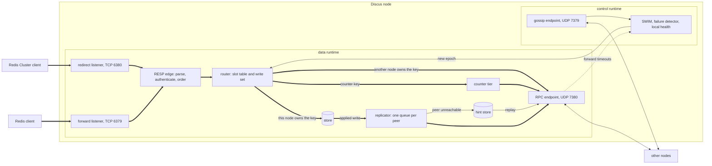

### 4.1 Threads and runtimes

A node runs two tokio runtimes.

The data runtime is multi-threaded. It runs client connections, forwards, replication, handoff,
Raft, and the store. Its `on_thread_start` hook raises the nice value of each worker thread by
`--data-nice` (default 5). An unprivileged process can always lower the priority of its own
threads, so the pod needs no extra capabilities. If the call fails, the node logs one warning and
continues.

The control runtime is a current-thread runtime on one OS thread, `discus-control`, at nice 0. It
runs these tasks:

- The membership tick, the evidence reader, lease renewal, and DNS discovery.
- Outbound and inbound gossip, and the gossip QUIC endpoint.
- The admin server. `/healthz`, `/startupz`, and `/readyz` read node state only and run here.
  Handlers under `/admin/` send their work to the data runtime.

The control thread never runs store work. Membership work that touches the store, for example
epoch adoption, goes to the data runtime through a stored `tokio::runtime::Handle`. Membership
state stays behind one `parking_lot` mutex that both runtimes can lock.

A cgroup CPU limit throttles every thread in the cgroup after the quota runs out, the control
thread too. The nice value decides only which thread runs first inside the quota. The control
thread uses little CPU, so it runs early in each period. Its worst-case wait is about one quota
period, 100 ms by default. That is well inside the 500 ms probe timeout.

On shutdown, the control thread stops after the data runtime finishes its graceful shutdown. So
the node gossips its departure until the end.

## 5. Placement

The slot of a key follows the Redis Cluster specification:

1. Find the first `{` in the key. If a `}` comes after it, with at least one byte between them, the
   bytes between them are the hash tag.
2. The slot is CRC16 of the hash tag, or of the whole key without a tag, modulo 16384. The CRC16 is
   the XMODEM variant (polynomial 0x1021, initial value 0), from the `crc` crate.

The range of a slot is `slot / 8`. The owners of range `r` come from HRW over the members. For
range `r` and member `n`, derive `u(r, n)` in `(0, 1)` from a stable hash of `r` (two bytes, big
endian) and `n.id`:

```text
score(r, n) = n.weight / -ln(u(r, n))
owners(r)   = the top min(RF, N) NORMAL members by score, in descending order
```

- Every weight starts at 1. Do not use `hash * weight`, because it does not weight proportionally.
- The hash is 64-bit xxh3 with the fixed seed `PLACEMENT_SEED`, never `DefaultHasher`.
- `SLOTS = 16384`, `SLOTS_PER_RANGE = 8`, `RANGES = 2048`, and the seed are part of the placement
  format. A change to any of them is a breaking change (§13.3).
- `RF` defaults to 3. One node has no secondaries, and two nodes have one. Every node of a cluster
  must use the same `--replication-factor`.
- Only `NORMAL` members are candidates. Suspicion does not remove a member. Only `DEAD` does. A
  `LEAVING` member leaves placement at once but serves until shutdown. Failover is placement
  recomputed after a `DEAD`. There is no separate promotion protocol.
- Keys with the same hash tag share a slot and therefore share their owners. A multi-key command on
  one tag runs on one node. A hot tag puts its whole load on one primary, as in Redis Cluster.

Placement uses the slot, not the key bytes, because a Redis Cluster client must be able to compute
the owner of a key. It cannot compute HRW over the members.

### 5.1 Epochs

- An epoch is `(generation: u64, origin: NodeId)`, ordered lexicographically. It carries the sorted
  member list (IDs, addresses, states, weights) and the `cluster_id` that the bootstrap node mints.
  Epochs of different clusters are never compared (§6.3).
- A node that sees a member become `DEAD`, or a `JOINING` member become `NORMAL`, records the
  change. One node builds the next epoch: the `NORMAL` member of the current epoch with the lowest
  `NodeId` that the node does not see as suspect or dead. The builder waits a random 0 to 50 ms. If
  an epoch that shows the change arrives during the wait, the builder stops. Otherwise it creates an
  epoch with `generation = max(seen) + 1` and itself as origin. Every other node waits longer: three
  gossip periods, plus one period for each doubling of the cluster size. If no epoch that shows the
  change arrived by then, that node builds. Two nodes therefore build at once only in rare cases,
  for example when a partition makes them disagree about who is alive. The higher epoch wins. A
  losing creator applies its change again in the next epoch.
- Nodes can briefly compute different owner sets. Forwarding carries the epoch and a 2-hop budget,
  and previous-epoch fallback covers the gap. The invariant is one primary per key per epoch.
- A node keeps every epoch that a pending handoff references, and at least the last four. A rolling
  restart of N nodes creates about 2N epochs.
- When a node adopts an epoch, it stops replicating keys it no longer owns. In-flight writes at the
  old primary resolve by HLC.

### 5.2 Handoff

Every ownership gain triggers a handoff: a join, a death, or a drain. Without this, the replacement
replica after a death starts cold.

- For each range whose owner set gained a member, the surviving owners stream the entries to the
  new owner over `HANDOFF`. The new owner pulls from the primary first and asks the other owners
  for keys the primary misses. If the HLC of an entry is newer, it applies the entry.
- The old owner keeps its entries and forwards writes for the moved keys until the new owner
  acknowledges the handoff.
- Handoff is scan-and-filter. A node runs one scan at a time. The scan covers the range from the
  oldest epoch with a pending handoff to the newest epoch, and sends each entry to every owner
  gained in that span. Epochs that arrive during a scan wait for the next scan, so a burst of epochs
  costs one or two scans.
- Each scan first computes the set of ranges whose owner set changed, as 2048 bits. A key in an
  unchanged range costs one CRC16 and no HRW.
- Scans are rate-limited, run in the background behind a snapshot watermark, and respect
  `maxmemory`. A scan is O(dataset) per surviving owner.
- Previous-epoch fallback: while its handoff is incomplete, a new owner that misses a key asks the
  previous owners that are not current owners. The fallback ends in three cases: the handoff
  completes, the handoff is abandoned after bounded retries, or the previous owners leave. After
  that, a miss is a miss and the key refills lazily.

Because of this fallback, a new owner can serve a key before its entry arrives. No slot is ever
half moved from the view of a client, so Discus never sends `-ASK`.

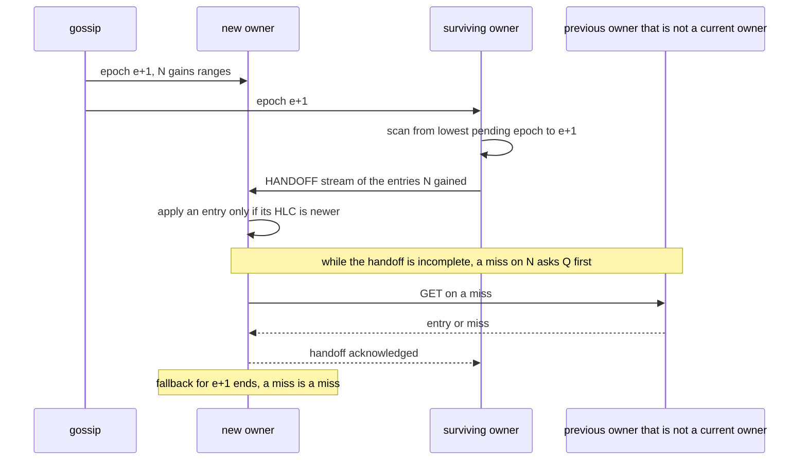

### 5.3 The slot table

Each epoch builds a `SlotTable` once. It holds the owners of each range as indices into the sorted
member list. With `RF = 3`, it takes 2048 × 3 × 2 bytes, which is 12 KiB.

- `Epoch` holds a `OnceLock<SlotTable>`. An epoch that a node decodes and never adopts never builds
  a table.
- `Node::adopt_epoch` builds the table before it takes the epoch write lock, so readers never wait
  for a build.
- Every owner lookup reads the table: `Epoch::owners`, `Epoch::primary`, `Epoch::slot_owners`, and
  `Epoch::range_owners`. Handoff, promotion digests, hints, replication queues, and
  `Node::previous_owners` all use it.
- A build computes `2048 × N` HRW scores, about 5 ms with 100 members. A lookup costs one CRC16 and
  one array read.

HRW per range moves only the ranges that gain or lose the changed member. A range is coarser than a
key, so the share of primaries per node varies more. With 2048 ranges, the busiest node has more
primaries than the mean: about 3% more with 3 nodes, 6% with 6 nodes, and 12% with 12 nodes. Finer
ranges balance better but make `CLUSTER SLOTS` larger: about 0.5 MB with 6 nodes at 2048 ranges,
against 4 MB at 16384. A client fetches the map again after each epoch change, so 2048 is the middle
point.

## 6. Membership

### 6.1 Gossip and failure detection

- SWIM uses a periodic ping, an indirect ping through peers, suspicion before death, and
  incarnation numbers that refute stale rumors. Dissemination is delta-based with a constant
  message rate per node and O(log n) propagation.
- Gossip runs over reliable QUIC streams with mTLS on its own UDP port (§13.1).
- The payload is the `NodeId`, the gossip, RPC, and client addresses, state (`JOINING`, `NORMAL`,
  `LEAVING`, `DEAD`), weight, epoch, capability bits, capacity hints, and counter leader hints.
- A phi-accrual detector with configurable thresholds decides suspicion and death. Data-path
  failures toward a peer (a forward timeout, a connection reset, a failed handshake) weigh more than
  a missed ping. If several entry nodes see a primary fail, the primary becomes `DEAD` faster than
  through gossip alone. Local health can hold back this evidence (§6.4).
- Probes run in parallel, at most one per target. A slow probe of a dead peer does not delay the
  probes of other peers.
- A `NodeId` lives for one process. Every restart is a leave plus a join with handoff. `DEAD` is
  final for an identity, except for a partitioned node that rejoins (§6.3).

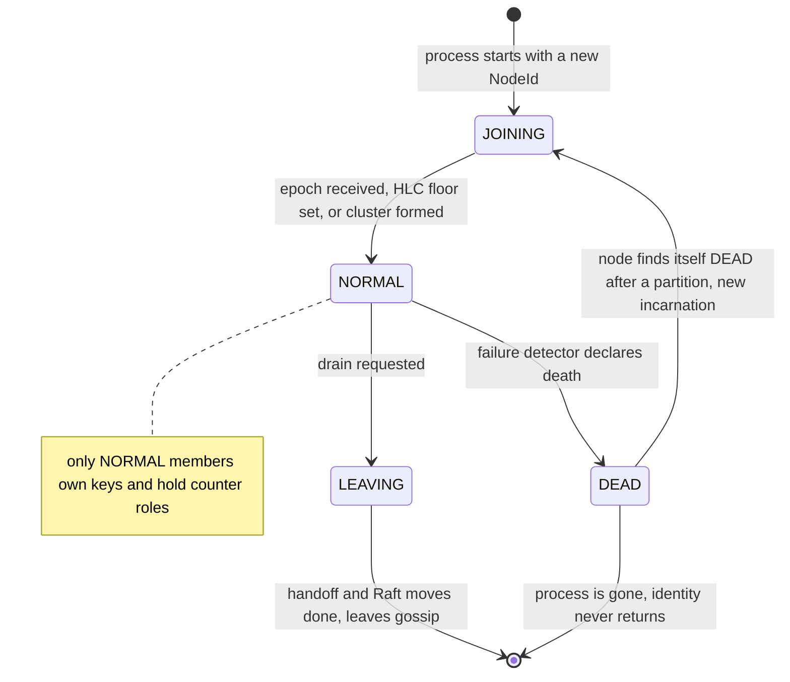

### 6.2 Bootstrap and the cluster lease

A Kubernetes `Lease` makes sure that only one node forms a new cluster.

- Discovery uses a headless Service with `publishNotReadyAddresses: true`, or a static seed list
  outside Kubernetes. Seeds point at the gossip port.
- A starting node looks for a `NORMAL` peer until the bootstrap deadline (default 10 s). If it
  finds one, it announces `JOINING`, receives the epoch and the HLC maximum, takes its handoff, and
  becomes `NORMAL`.
- If it finds none, it tries to acquire the `Lease` `discus-cluster` (`coordination.k8s.io/v1`) in
  its namespace. If the lease is unheld or expired, acquisition can succeed. The `resourceVersion`
  precondition makes it exclusive. The winner mints the `cluster_id`, creates epoch `(1, self)`,
  sets its HLC from the wall clock, creates the counter groups, and serves. A loser reads the holder
  address from the `discus.io/address` annotation, adds it as a seed, and keeps looking.
- Every `NORMAL` member runs acquire-or-renew (duration 15 s, renew every 5 s), so a live cluster
  always holds the lease. The holder writes `holderIdentity`, `discus.io/address`, and
  `discus.io/cluster-id`. After a full cold restart, the lease expires and the first node to
  acquire it forms a new cluster.
- The lease matters only for formation. If the API server is unreachable, a running cluster keeps
  serving. A node that reaches neither a `NORMAL` peer nor the API server stays unready.
- The lease provider `none` (outside Kubernetes) forms a cluster alone after the deadline. It
  cannot prevent a split bootstrap and is for single-node development only.
- With `--membership static`, the member list comes from `--peer` flags and there is no failure
  detector.

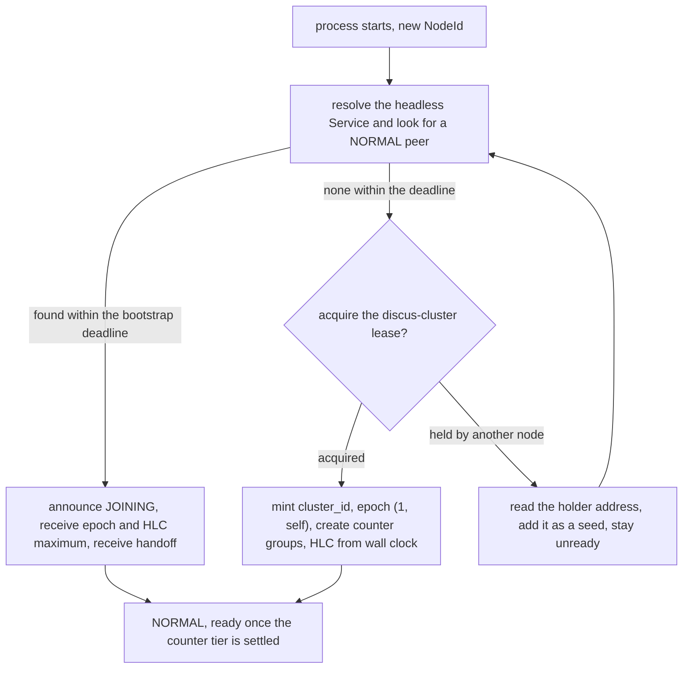

### 6.3 Partitions and merges

Split-brain is accepted for normal keys. Both sides of a partition serve, promote primaries, and
create epochs that mark the other side `DEAD`.

- On heal, the higher epoch wins. A node that is not `NORMAL` in an adopted epoch increments its
  incarnation and rejoins as `JOINING` with a handoff. It discards its counter state. If it was away
  for less than the tombstone TTL, it keeps its cache store. HLC last-write-wins resolves the
  conflicting writes.
- If two clusters formed independently, the cluster whose `cluster_id` matches the lease wins.
  Without lease access, the larger cluster wins, then the higher `cluster_id`. The losing nodes
  discard their store and counters and rejoin.

### 6.4 Local health

On an overloaded node, the reply to a forward waits behind thousands of client tasks. Almost every
forward then times out. One data-path timeout adds `data_path_weight` (10) of evidence, and the
Suspect threshold is 8. Without local health, the node marks healthy peers Suspect for its own
slowness. Local health follows Lifeguard (Dadgar et al., 2018), with lag as its only input.

A task on the data runtime runs a 10 ms tokio interval with `MissedTickBehavior::Skip`. It stores
how late each tick fired, in milliseconds, in an `Arc<AtomicU64>`. The membership tick on the
control thread reads this value and calls `swim.observe_lag(lag_ms)` before `swim.tick(...)`.
Because the tick runs on the control thread, it keeps sampling while the data runtime stalls.

`LocalHealth` in `discus-membership` turns the samples into a score and a multiplier. It keeps a
level `L` and a trend `T`, both in milliseconds and both starting at 0. For each sample `x`:

```text
a  = if x >= L { alpha_up } else { alpha_down }
L' = max(a * x + (1 - a) * (L + T), 0)
T' = max(beta * (L' - L) + (1 - beta) * T, 0)
score      = L' + horizon * T'
multiplier = clamp(1 + max(score - deadband, 0) / unit, 1, max_multiplier)
```

The score is a Holt forecast: a smoothed level plus a smoothed trend. Only a rising trend counts.
The level follows a rise in about 5 samples and a fall in about 100.

The parameters are the `health_*` fields of `SwimConfig`, with no command-line flags. Lag below
the 10 ms deadband counts as scheduling noise, the multiplier stops at 9, and the evidence cutoff
is 1.5. With the defaults, a step to 200 ms of lag reaches the maximum multiplier on the first
sample. After the lag returns to 0, the multiplier falls below
1.5 after about 2.6 s and reaches 1 after about 3 s.

The SWIM core reads the multiplier `m` at each decision point:

- `evidence(now, peer)` adds nothing while `m >= health_evidence_cutoff`, and counts the dropped
  item. The forward itself does not change: a timed-out forward still tries the next owner.
- The direct and indirect probe timeouts are multiplied by `m`. The probe interval does not scale.
  If every node lags, a longer interval cuts the heartbeat rate of every node, and phi then suspects
  healthy peers.
- The suspicion timeout and its minimum are multiplied by `m`. If `m` falls during a suspicion, the
  suspect can become Dead sooner. That is intended, because the node can trust its own timing again.
- The Suspect and Dead thresholds do not scale. Phi is a log-scale value, so a scaled threshold
  turns suspicion off in practice.
- Join, lease, and sync timers do not scale. Missed-probe evidence still counts, so a dead peer
  still becomes Dead, within `9 × suspicion_max_ms` plus the scaled probe time (90 s with the
  defaults).

The diagram shows how lag turns into a multiplier and how the multiplier gates data-path
evidence.

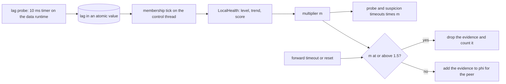

## 7. Request path

1. The client connects to any node. An ordinary client goes through the load balancer to the
   forward listener. A cluster client connects to the node that its slot map names.
2. The entry node parses RESP, authenticates the connection, and authorizes the command (§14).
3. A counter key goes to its group leader (§10). Other keys continue.
4. The router finds the owners of the slot in the slot table and checks the write set.
5. A write goes to the primary. If the local node is an owner, it serves a read. Otherwise an owner
   chosen by per-connection round-robin serves it, so reads of a hot key spread over every replica.
   A key in the write set, or a primary-read key, reads from the primary.
6. If the target is another node, the forward listener forwards over QUIC. On the redirect
   listener, if the redirect rule allows it (§7.6), the node returns `-MOVED`. Otherwise it
   forwards.
7. The entry node returns the reply as RESP.

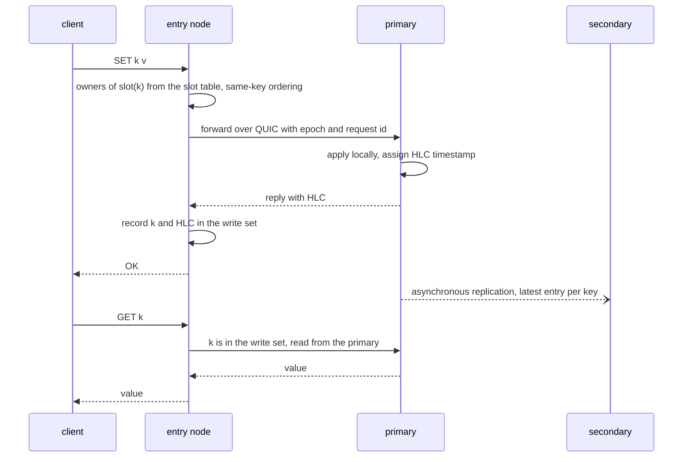

### 7.1 Ordering

- Pipelined replies return in request order. The entry node numbers requests per connection,
  dispatches them concurrently, and buffers out-of-order replies.
- Commands on the same key on one connection execute in client order. A command waits while an
  earlier command on any of its keys is in flight. Commands on disjoint keys run concurrently.

### 7.2 Epoch disagreement

- A forwarded request carries the epoch of the sender. If the receiver is behind, the request also
  carries the full epoch. A receiver with a lower epoch adopts the higher one before it acts. The
  reply reports the epoch of the receiver.
- A node that does not own the key forwards again, up to 2 hops, with loop detection. When the
  budget runs out, it uses the previous-epoch owner or returns `-TRYAGAIN`.

### 7.3 Multi-key commands

- `MGET` groups keys by owner, fans out, and merges the replies in order. The keys of one slot
  always share a target.
- `MSET` and multi-key `DEL` fan out and are not atomic. If any part fails, the command returns
  `-TRYAGAIN` and the other parts stay applied. A retry of the whole command is safe. If the node
  cannot know whether a part applied, the reply says so.
- `SCAN` and `RANDOMKEY` are local to the entry node. `DBSIZE` is a fan-out estimate. `FLUSHDB` and
  `FLUSHALL` broadcast best-effort.
- On a redirect connection, a command with all keys in one slot acts like a single-key command. A
  command with keys in several slots fans out as above. Discus does not return `-CROSSSLOT`,
  because it can serve the command. `SCAN` and `DBSIZE` change on a redirect connection (§7.6).

### 7.4 Write set

- After a write, the entry node records the key and the acknowledged HLC. A read of the key goes to
  the primary, or to a replica that reports an applied HLC at least as new.
- An entry leaves the set after a read that observes a new enough HLC, after 5 s, or by LRU. The
  bounds are 4096 keys or 1 MiB per connection, and 1% of `maxmemory` per node.
- The set does not survive a reconnect or a move to another entry node. Counter keys and
  primary-read keys do not use it. A primary-read key always reads from the primary, so it needs
  no write set.
- On a redirect connection, a client writes to the primary directly, so reads on the same
  connection go to the same primary. Read-your-writes follows from the routing.

### 7.5 Timeouts and failover

- The read forward timeout is 20 ms, after which the entry node tries the next replica. The write
  forward timeout is 200 ms.
- If a write to the primary fails or times out, the entry node reports the peer to the failure
  detector and holds the command. When an epoch with a new primary for the key arrives, it sends
  the command there. After the hold budget (`--hold-budget-ms`, 3 s), it returns `-TRYAGAIN`. Held
  commands count against the pipeline limit and keep same-key order.
- A command that was never transmitted is always safe to send again. If a transmitted command gets
  no reply, the entry node sends it again only for these idempotent commands: `SET` without `NX` or
  `XX`, `DEL`, `EXPIRE`, `PEXPIRE`, `EXPIREAT`, `PEXPIREAT`, `PERSIST`, `MSET`, `HSET`, `HDEL`,
  `SADD`, `SREM`, `ZADD` without `INCR`, and `ZREM`. Every other command, for example `INCR`,
  `APPEND`, `GETDEL`, `SPOP`, `SET NX`, or the take inside `RENAME`, returns `-TRYAGAIN` once its
  delivery is in doubt.

The diagram shows a held write during a failover.

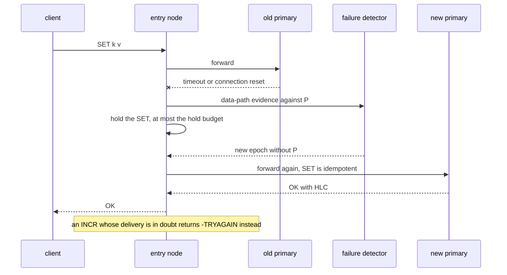

### 7.6 Cluster clients and MOVED

A node has one or two RESP listeners. Both accept every command and use the same TLS mode,
certificates, authentication policy, and limits.

| Listener | Flag | Default | A key that another node serves |
| --- | --- | --- | --- |
| Forward | `--listen` | `0.0.0.0:6379` | The node forwards the command. It never sends `-MOVED`. |
| Redirect | `--redirect-listen` | off | The node returns `-MOVED` by the rule below, or forwards. |

The redirect rule. On a redirect connection, a command first passes the entry checks and the
counter intercept. A counter command goes to its leader and never gets `-MOVED`. For any other
command:

1. If the command has no key, or its keys fall in more than one slot, the node plans it as on the
   forward listener.
2. The node finds the target of the slot. For a write, the target is the primary. For a read, if
   the connection sent `READONLY`, `--read-from-replicas` is true, and this node owns the slot,
   the target is this node. Otherwise it is the primary. The write-set rule comes first.
3. If the target is this node, the node serves the command, with read repair and the handoff
   fallback.
4. If the target is another node `T` and all three of these conditions are true, the node
   returns `-MOVED <slot> <endpoint>:<port>` with the client address of `T`:
   - The current epoch lists `T` as `NORMAL` with a client address.
   - `T` is up.
   - `T` reported the same epoch as this node or a newer one.
5. Otherwise the node forwards the command. Holds apply.

Only hop 0 can return `-MOVED`. A forwarded command never gets one. The decision in step 4 is a
pure function in `cluster/redirect.rs`.

The diagram shows the redirect rule as a decision.

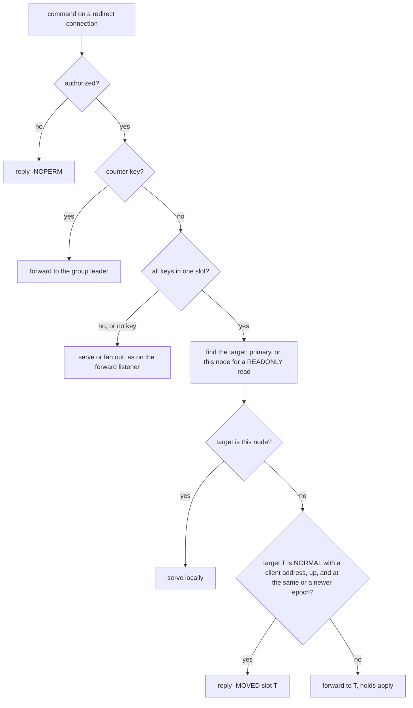

Target health. Two signals must both say that `T` is up. With gossip, SWIM must see `T` as `Alive`.
Static membership has no detector, so this signal always passes there. The transport sees `T` as
down while its replication queue to `T` is down, or while its last forward to `T` failed. A later
successful forward or replication batch ends that state. A node with no traffic to `T` has no
evidence against it. Its first misrouted command can then follow `-MOVED` to a dead node, and the
client retries through the topology, as in Redis Cluster.

Epoch changes. A peer reports only epochs that it adopted, so every `-MOVED` points to a node with
the same epoch or a newer one. In one epoch, every node names the same target. So a chain of
redirects has at most one redirect per newer epoch, and nodes never send a client back and forth.
A draining node leaves placement in the next epoch, and its redirect connections then get `-MOVED`
to the new owners. A joining node receives redirects once it reports the new epoch.

Failover. A cluster client sees a failed primary as a connection error and retries through another
node. That node sees the primary as down, so it forwards and holds the write (§7.5). After the epoch
removes the primary, the client gets `-MOVED` to the new one.

Counter keys. A slot holds normal keys and counter keys, and the leader of a counter group is not
the owner of the slot. A `-MOVED` to the leader makes the client send the normal keys of that slot
to the leader too, so Discus does not send it. A counter command from a cluster client therefore
takes one forward, unless the client reaches the leader by chance.

The diagram shows a cluster client that follows an epoch change.

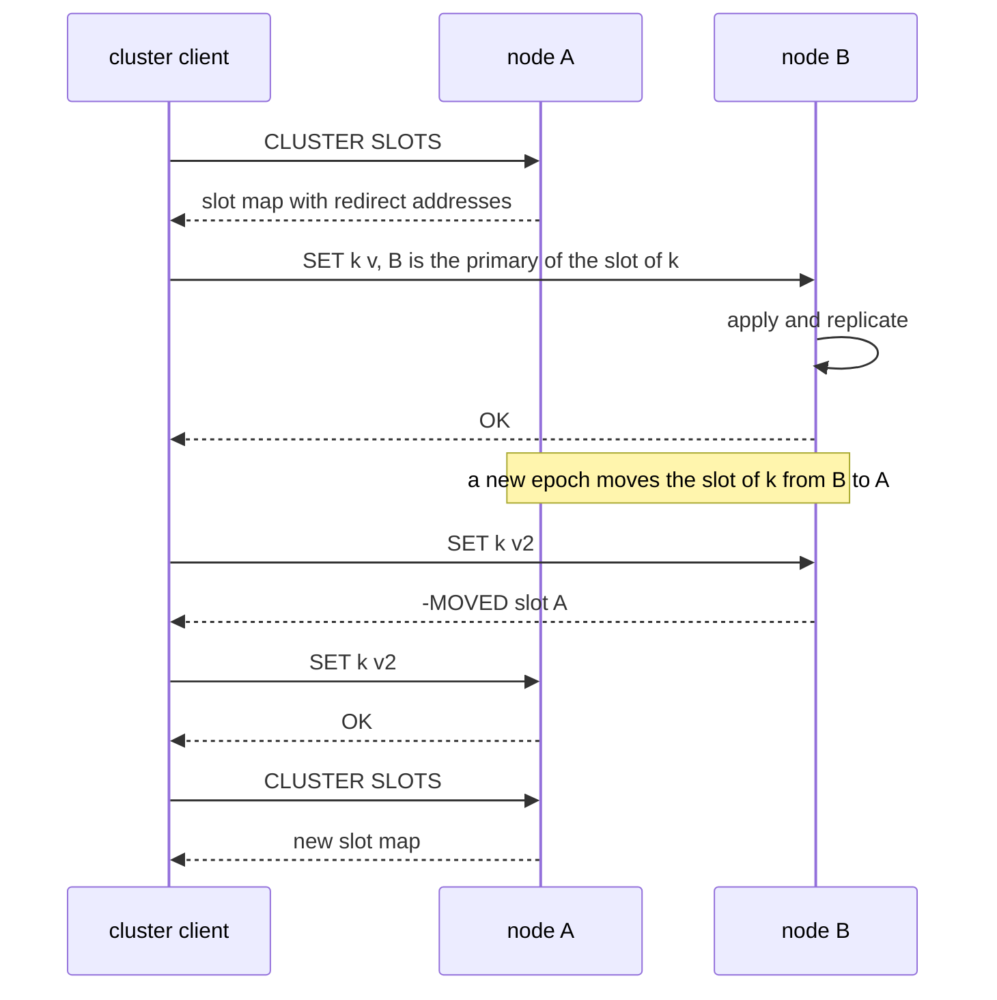

Keyspace commands on a redirect connection:

| Command | Behavior |
| --- | --- |
| `SCAN` | Lists only the keys of the slots that this node is the primary of. A cluster client scans every primary, so each key appears once. |
| `DBSIZE` | The local key count divided by the copies per key. The sum over all primaries equals the cluster estimate. |
| `FLUSHDB`, `FLUSHALL` | Every member, best-effort. A cluster client sends the command to every primary, so the flush runs several times. That is safe. |

`--cluster-topology` takes `auto` (default), `on`, or `off`. With `auto`, if the node has a redirect
listener, the topology commands (§12.2) answer. Otherwise `CLUSTER` returns an error. With `on` and
no redirect listener, the replies name the `--listen` addresses. A cluster client then routes
directly but never gets `-MOVED`. That setting is for tests.

## 8. Consistency and replication

### 8.1 Semantics

- Normal keys are AP and eventually consistent. Reads can be stale.
- Each key has one primary, so `INCR`, `SET NX`, and `SET XX` are atomic there. A normal-key `INCR`
  can lose increments across a failover. Exact counts use `cnt:` keys.
- Conflicts resolve by HLC, then by origin `NodeId`.
- A node never issues an HLC more than 1 s ahead of its wall clock, and drops incoming messages
  that are further ahead. A node pinned at that bound returns `-TRYAGAIN` for writes and raises an
  alarm.
- Before it becomes `NORMAL`, a joining node sets its HLC to at least the cluster maximum it
  receives. If a `NORMAL` peer is reachable but does not answer, the node does not serve writes.
  Only the bootstrap node starts from the wall clock.
- Deletes write tombstones. The cache eviction policy does not evict tombstones. They use a
  separate reserve. If the reserve is full, the node evicts normal entries first. Then it drops the
  oldest tombstones and marks the shard `needs_refill`, so a rejoin discards that shard.
- TTLs replicate as an absolute deadline in Unix milliseconds. Expiry is lazy on access plus a
  sampled sweep. Clocks are assumed within 100 ms through NTP.
- There is no cross-key atomicity.

### 8.2 Replication

- The primary acknowledges after it applies the write locally (`W = 1`) and then enqueues it per
  peer. There is no `WAIT`. The one exception is a delete of a primary-read key: it waits up to
  `--replication-timeout-ms` for one secondary, then replies with success anyway (§19).
- A queue keeps only the latest full entry per key. If the HLC of an entry is newer, the replica
  applies it. Replication is therefore idempotent and order-tolerant.
- On queue overflow, the primary drops the oldest entries, marks the peer lagging, and records
  hints (§9).
- Read repair is miss-driven. A replica that misses asks the primary or another replica and stores
  what it finds. Hits are not compared across replicas.
- A promoted primary exchanges per-shard HLC digests with the other replicas once and pulls newer
  entries. Continuous anti-entropy is out of scope.
- Repair treats tombstones as entries, so repair cannot bring back a deleted key.
- A replica that was unreachable for longer than the tombstone TTL discards its store on rejoin.

## 9. Hinted handoff

- If the primary cannot deliver a write to a secondary, it records a hint. Causes are a failed
  connection, a timeout, a peer that is not `NORMAL`, or a queue overflow.
- Hints live on the primary, keyed by target and key. A hint holds the full entry and its epoch.
  Hints coalesce to the latest entry per key.
- Bounds are a byte cap and an entry cap per target, a global cap (5% of `maxmemory`), and a
  maximum age equal to the tombstone TTL. The oldest hints are evicted and counted.
- Replay starts in two cases: the target is `NORMAL` and reconnected, or the queue of a lagging peer
  drains below a low-water mark. The primary sends `HINT_REPLAY` batches in HLC order and waits for
  an acknowledgment per batch. The target applies only newer entries.
- A `DEAD` target never returns, so its hints are dropped. Hints cover transient unreachability and
  slow peers, not restarts.
- On every epoch change, the primary drops the hints whose target no longer owns the key.
- If a hint is lost before replay, the primary marks the affected refill buckets `needs_refill` for
  that target, and the target discards them on rejoin.
- Hints die with the primary. Promotion reconciliation covers that case.

The diagram shows the path of a write from the primary to one secondary, with and without hints.

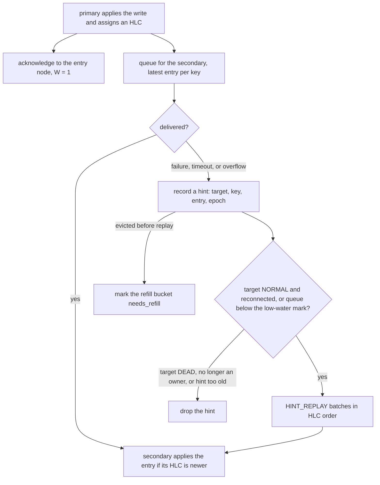

## 10. Strong counters

Keys under a configurable prefix (`--counter-prefix`, default `cnt:`) are linearizable. Every
command on such a key takes the strong path. Otherwise a plain `SET` on the asynchronous path can
overwrite a counter with a stale value. The prefix decides the path before the value is read.

The strong keyspace splits into `G` groups (`--counter-groups`, default 8, at most 1024). The group
of a key is `slot(key) % G`. Counter keys with one hash tag fall in one group, so a multi-key
command on them is atomic. Each group has one leader that serializes its keys. The entry node
forwards strong commands, including reads, to the leader. Nodes learn the leader from gossip hints,
the group lease, or `RAFT_LEADER`. A node that is not the leader answers `RAFT_LEADER` with no
leader.

A group runs in leader-follower mode below three `NORMAL` members and in Raft mode from three. A
two-voter Raft group cannot survive a loss, so small clusters use leader-follower mode instead.

### 10.1 Leader-follower mode

- The `Lease` `discus-counter-<g>` names the leader (duration 5 s, renew every 1 s).
- The leader serves only while its lease is valid by its own monotonic clock, minus a 1 s margin.
  Otherwise it returns `-TRYAGAIN`. Two leaders never serve one group at the same time.
- Leadership is sticky. When the lease expires, the follower tries to acquire it first. Other
  members wait one more lease duration.
- The leader sends each entry to the follower and waits up to 50 ms for the acknowledgment. On a
  timeout it marks the follower lagging, replies anyway, and sends a fresh snapshot later. A joining
  follower receives a snapshot.
- Failover takes about one lease duration and loses the increments that a lagging follower missed.
  With one node, a node loss loses the counters. Counter availability in this mode depends on the
  API server.
- With the lease provider `none`, the epoch names the leader: the previous leader, else the
  previous follower, else the top member by HRW. This mode cannot fence a leader and is for
  development only.

### 10.2 Raft mode

- The leader appends the command to an in-memory log, replicates to a quorum (2 of 3), commits,
  applies, and replies. Commands are batched per append.
- The target voters of group `g` are the top three `NORMAL` members by HRW with `g` as the key.
- The leader adds each missing target as a learner and waits for it to catch up. When all three
  targets are ready, the leader replaces the voters with the targets in one change. A ready target
  is a live voter or a learner that caught up. The leader can be outside the new set. It commits
  the change and then steps down. Changes are rate-limited across groups.
- The leader never makes a group of two voters. A group of two needs both voters, and one lost
  replica then stops the group. A single voter waits until two learners are ready. A dead voter
  stays listed until its replacement is ready.
- If a majority of the newest voter set is alive, the leader can start a change. Otherwise it
  waits. A joint change that a previous leader left behind ends at the next step of the current
  leader. If all targets are ready, it ends in the target set. Otherwise it ends in its own newest
  set.
- If the epoch marks a voter `DEAD`, or the voter is unreachable for `--raft-voter-timeout-ms`, the
  leader treats it as dead and replaces it. A learner in that state leaves the group at once. A
  live peer that refuses a replica proves that the replica is gone, and the leader acts without
  the wait.
- Gossip carries only a leader hint. Nodes learn the configuration from the leader or
  `RAFT_CONFIG`. A node without the configuration does not serve `cnt:` commands.
- The log, snapshots, and votes live in memory. This is safe because a restarted pod has a new
  `NodeId` and enters a group only as a learner. No identity votes twice, and no empty node is a
  voter.
- A minority partition returns `-TRYAGAIN`.
- Quorum loss recovers automatically. When a voter set has no live majority, a joint change
  included, no membership change can commit. The leader, or else the top live voter, then
  reconfigures the group to itself as the only voter of a new instance. When every voter is
  `DEAD`, the top target creates the group again, empty, and its counters are lost.
  `RAFT_FORCE_RECONFIGURE` on the admin port lets an operator act before the detector declares the
  voters `DEAD`.
- A false `DEAD` during a partition lets both sides rebuild a group. On heal, the losing side
  discards its counter state, and the increments it accepted are lost.

The diagram shows a counter write in Raft mode.

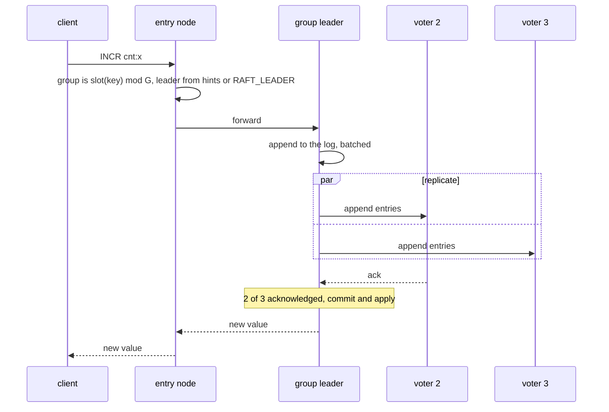

### 10.3 Mode switches

- Up: after three `NORMAL` members for the dwell time (30 s), each lease holder creates a Raft group
  with itself as the only voter and its state as the snapshot. It then lets the lease expire. The
  other members join as learners.
- Down: below three members, the group switches at once. The Raft leader takes the lease. If the
  leader is gone, a surviving voter takes it. Other members wait one lease duration first. If quorum
  was already lost, the last committed entries can be lost.
- The epoch drives both switches, so every node agrees on the mode of every group.

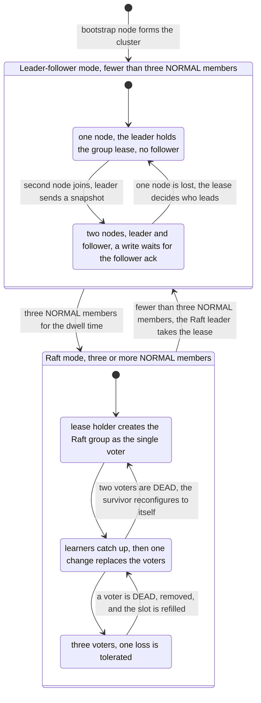

### 10.4 Other counter rules

- `INCR key EX|PX|EXAT|PXAT` is an atomic extension for rate limiting. The leader stamps every
  command with its clock, and the state machine expires keys against that stamp, never against the
  local clock. Replicas therefore agree on expiry.
- A change of `G` is an offline procedure: pause strong writes, snapshot each group, reassign keys,
  restart the groups, and resume. Linearizability does not hold across it.
- If a counter command got no reply, the entry node cannot know whether it applied. It returns
  `-TRYAGAIN` with a message that says so. A fan-out passes that message on unchanged.
- The p99 target for a counter write is 5 ms. Counter throughput scales with `G`, not with group
  size.
- If the counter memory reserve is full, counter writes return `-OOM`. A full cold restart loses
  every counter.

### 10.5 Growth from one node to three

A single node holds every lease, with an effective `RF` of 1. A second node gains every range, so
it receives a handoff of the whole store and becomes the follower of every group (`RF` 2). A third
node makes `RF` 3, and after the dwell time every group switches to Raft. Shrinking runs the same
steps in reverse.

## 11. Storage

- The store has `--shards` shards (default 256). Each shard has its own map, TTL index, eviction
  state, and lock. There is no global lock.
- Value types are strings, hashes, sets, and sorted sets. A collection is stored and replicated as
  one value, with a configurable size guard.
- `maxmemory` is one budget for everything: entries, tombstones, hints, write sets, and counter
  state. The hint cap, write-set cap, tombstone reserve, and counter reserve are shares of it. At
  the limit, the node evicts normal entries, then the oldest hints, then the oldest tombstones with
  `needs_refill`. It never evicts counter state or write sets. Counters return `-OOM`, and write
  sets are bounded at admission.
- Eviction is sampled approximate LRU per shard. Replicas evict independently, and read repair
  covers the resulting misses.
- Expiry has no timer per key (§8.1). The sampled sweep keeps a cursor per shard, so repeated sweeps
  cover the whole shard.
- The default limits are 64 KiB per key, 64 MiB per value, and 10000 in-flight commands per
  connection. A connection over the pipeline limit is not read until replies drain.
- There is no persistence.

## 12. Protocol surface

Supported commands:

- Connection: `PING`, `ECHO`, `QUIT`, `AUTH`, `HELLO` (RESP2/RESP3), `SELECT` (every database,
  §12.3), `COMMAND` (§12.2), `CLIENT` (`SETNAME`, `GETNAME`, `ID`), `INFO`, `CONFIG GET` (subset),
  `READONLY`, `READWRITE`, and `ASKING`.
- Cluster: the `CLUSTER` subcommands in §12.2.
- Strings: `GET`, `SET` (`EX`, `PX`, `EXAT`, `PXAT`, `NX`, `XX`, `KEEPTTL`, `GET`), `GETDEL`,
  `GETEX`, `DEL`, `EXISTS`, `EXPIRE`, `PEXPIRE`, `EXPIREAT`, `PEXPIREAT`, `TTL`, `PTTL`, `PERSIST`,
  `TYPE`, `MGET`, `MSET`, `INCR`, `DECR`, `INCRBY`, `DECRBY`, `INCRBYFLOAT`, `APPEND`, and `STRLEN`.
- Hashes: `HSET`, `HSETNX`, `HGET`, `HMGET`, `HGETALL`, `HDEL`, `HEXISTS`, `HLEN`, `HINCRBY`,
  `HKEYS`, and `HVALS`.
- Sets: `SADD`, `SREM`, `SMEMBERS`, `SISMEMBER`, `SMISMEMBER`, `SCARD`, `SPOP`, and `SRANDMEMBER`.
- Sorted sets: `ZADD`, `ZSCORE`, `ZMSCORE`, `ZREM`, `ZCARD`, `ZRANGE`, `ZREVRANGE`, `ZRANGEBYSCORE`,
  `ZINCRBY`, and `ZCOUNT`.
- Keys: `RENAME` (§19.1), `MOVE`, `COPY`, `SCAN`, `RANDOMKEY`, `DBSIZE`, `FLUSHDB`, and `FLUSHALL`,
  with the limits in §7.3. `SWAPDB` returns `-ERR SWAPDB is not allowed in cluster mode`.
- Strong counter keys accept the string and expiry commands above.

`INFO` reports `redis_version:7.2.0`, and the `HELLO` reply carries `version` `7.2.0`, because
clients gate features on that field. A `discus` section in `INFO` reports the build ID, the build
features, the TLS backend (§15.5), `discus_redirect_addr`, and `discus_client_addr`. A `# Cluster`
section shows `cluster_enabled:1` while the topology commands answer, else `cluster_enabled:0`.

These commands return `-ERR command not supported by Discus`: `MULTI`, `EXEC`, `DISCARD`, `WATCH`,
`UNWATCH`, `EVAL`, `EVALSHA`, `SCRIPT`, `FUNCTION`, `SUBSCRIBE`, `PSUBSCRIBE`, `PUBLISH`, `PUBSUB`,
`BLPOP`, `BRPOP`, `BLMOVE`, `BRPOPLPUSH`, all stream commands, `SORT`, `RENAMENX`, `SUNIONSTORE`,
`SINTERSTORE`, `SDIFFSTORE`, `BITOP`, `BITFIELD`, `PFADD`, `PFCOUNT`, `GEO*`, `MIGRATE`, `WAIT`,
and `DEBUG`.

### 12.1 Documented deviations

Each deviation is explained in the section in parentheses.

- `MSET` and multi-key `DEL` are not atomic, and Discus never returns `-CROSSSLOT` (§7.3).
- `SCAN` is local, `DBSIZE` is approximate, and both exclude counter keys. `FLUSHALL` is
  best-effort (§7.3).
- Reads can be stale. Read-your-writes is best-effort and per connection (§7.4).
- Non-idempotent writes can return `-TRYAGAIN` during a failover. A retried `SET NX` can report
  failure for a value that the client did set (§7.5).
- A node failure can lose the last writes, including deletes (§8.2). After a lost `DEL`, the old
  value stays until its TTL expires, so a cache that relies on invalidation needs a TTL as a
  backstop. A delete of a primary-read key narrows this window but does not close it (§19.1).
- A normal-key `INCR` can lose increments across a failover (§8.1). Under split-brain, only one
  side's field updates of a collection survive (§6.3, §11).
- Counters can lose increments below three nodes, on the losing side of a partition, and in a full
  cold restart (§10).
- `RENAME` is not atomic, and a failure can lose the value (§19.1).
- Discus never sends `-ASK`, has no slot management, and `CLUSTER NODES` shows no replicas (§12.2).
- `MOVE` and `COPY` are not atomic across a failover (§12.3).
- `SCAN` and `RANDOMKEY` stay local, and `DBSIZE` stays an estimate, for each database (§12.3).
- The node refuses `SWAPDB`, as a Valkey cluster does (§12.3).

### 12.2 Cluster and COMMAND replies

A Discus node ID has 32 hex digits, and Redis node IDs have 40. Every reply shows the 32 digits
followed by `00000000`, so clients that check the length accept it.

| Command | Reply |
| --- | --- |
| `CLUSTER SLOTS` | One entry for each run of consecutive slots with the same ordered owner list. |
| `CLUSTER SHARDS` | One shard for each distinct ordered owner list. |
| `CLUSTER NODES` | One line for each `NORMAL` member. |
| `CLUSTER INFO` | The state of the cluster, as text. |
| `CLUSTER KEYSLOT <key>` | The slot of the key. |
| `CLUSTER MYID` | The 40-digit ID of this node. |
| `CLUSTER COUNTKEYSINSLOT`, `CLUSTER GETKEYSINSLOT` | `-ERR` that says Discus does not support it. These need an index by slot. |
| Every other `CLUSTER` subcommand | `-ERR Discus places slots by itself. CLUSTER <name> is not supported`. |
| `READONLY`, `READWRITE` | `OK`. They set and clear the `readonly` flag of a redirect connection. On the forward listener they change nothing. |
| `ASKING` | `OK`, with no effect. |

The topology commands (`SLOTS`, `SHARDS`, `NODES`, `INFO`) answer on both listeners and always name
the redirect listeners. Each node answers from its current epoch, encodes each reply once per epoch
and protocol, and serves the cached bytes. A node that is not `NORMAL` returns
`-TRYAGAIN the cluster is changing, try again later`. While a `NORMAL` member has no client
address, they return `-ERR the cluster topology is not complete, member <id> has no client address`.

- `CLUSTER SLOTS`: each entry is `[start, end, primary, secondary, ...]`. Each node is
  `[endpoint, port, id, metadata]`. If `--client-hostname` is set, the endpoint is the host name and
  the metadata holds the IP. Otherwise the endpoint is the IP and the metadata is empty. This is the
  Redis 7 format.
- `CLUSTER SHARDS`: `slots` is a flat list of start and end pairs. `nodes` lists the owners in owner
  order. Each node has `id`, `port` or `tls-port`, `ip`, `endpoint`, `role`, `replication-offset`,
  and `health`. If a host name is set, it also has `hostname`. The role is `master` for the primary
  and `replica` for the others. The offset is 0, and the health is `online`. A node appears in many
  shards.
- `CLUSTER NODES`: each line is
  `<id> <ip>:<port>@<rpc port>[,<hostname>] <flags> - 0 <now ms> <generation> connected <slots>`.
  The flags are `myself,master` or `master`. The slots are the ranges that the member is the primary
  of. This format cannot show a node that is the primary of some slots and a replica of others, so
  the lines show no replicas.
- `CLUSTER INFO`: if this node is `NORMAL` and every slot has a primary, `cluster_state` is `ok`.
  Otherwise it is `fail`. The other fields are `cluster_slots_assigned:16384`,
  `cluster_slots_ok:16384`, `cluster_slots_pfail:0`, `cluster_slots_fail:0`, `cluster_known_nodes`,
  `cluster_size` (members that are the primary of at least one slot), `cluster_current_epoch`, and
  `cluster_my_epoch`. Both epoch fields show the generation of the current epoch.
- A single node without a cluster answers with one range, 0 to 16383, that names itself. Without an
  advertised address, it names the local address of the connection that asks.

`COMMAND` returns the Redis 7 shape, because some cluster clients, for example redis-py and
go-redis, read it to find key positions and read-only commands. Each entry has the name, the arity,
the flags (`readonly` or `write`), the first key, the last key, and the step. The ACL categories,
tips, key specifications, and subcommands are empty arrays.

| Route | First key, last key, step |
| --- | --- |
| `Single` | 1, 1, 1 |
| `MultiRead`, `MultiWrite { pairs: false }` | 1, -1, 1 |
| `MultiWrite { pairs: true }` | 1, -1, 2 |
| Every other route | 0, 0, 0 |

`COMMAND INFO <name> ...` returns the same entries. `COMMAND GETKEYS` returns the keys from
`keys_of`. `COMMAND DOCS` is empty.

### 12.3 Numbered databases

A node serves the databases from 0 to the count of the cluster minus 1. The flag `--databases`
sets the count of a node. It takes a value from 1 to 65536, and the default is 1. A connection
starts in database 0. Database 0 is a database like every other one: it has the same store
structure, the same code paths, and the same wire fields. A key name has the same slot and the
same owners in every database.

- The store keeps one key space for each database. `FLUSHDB`, `DBSIZE`, `SCAN`, and `RANDOMKEY`
  work on the selected database. `INFO keyspace` shows one line for each database that holds keys.
- Every message that carries a key on the data path has a field `db`. The default is 0, so a
  message for database 0 has the same bytes as before.
- Strong counters are kept for each database. `MOVE` and `COPY` refuse a counter key.
- `COPY` reads its source on the primary.
- A gossip record carries the count of its node. The count of the cluster is the smallest count of
  the `NORMAL` members. A raise applies at once. A lower count applies only after it holds for 10
  seconds, and never while a member has no gossip record. Then each node deletes the data of the
  removed databases. After that, a node refuses replicated data for a removed database until the
  count rises again. The metric `discus.databases.dropped` counts the refused entries.
- A joining node takes the larger count, unless it runs `--lower-databases`.
- The capability bit `MULTI_DB` gates the feature (§13.3). A node without it cannot join a cluster
  with more than one database. In such a cluster, while any member lacks it, `SELECT` above 0,
  `MOVE`, and `COPY` return `-ERR multiple databases need every node to support them`.
- `--membership static` refuses `--databases` above 1, because static nodes do not gossip.

`docs/cluster.md` has the operator steps.

## 13. Transport and wire format

### 13.1 QUIC

- Use `quinn` with `rustls` and TLS 1.3. Every node-to-node connection uses mTLS. Plaintext is
  never allowed, even in development. Use a local test CA.
- Each node has two QUIC endpoints on two UDP ports, with the same TLS configuration:
  - The gossip endpoint binds `--cluster-listen` (UDP 7379), accepts only `discus-gossip`, and runs
    on the control runtime.
  - The RPC endpoint binds `--rpc-listen` (UDP 7380), accepts only `discus-rpc`, and runs on the
    data runtime. `--rpc-advertise` defaults to the IP of `--cluster-advertise` with the port of
    `--rpc-listen`.
- The separate gossip socket keeps membership traffic out of the queue of data traffic on an
  overloaded node (§4.1, §6.4).
- Keep one or two long-lived RPC connections per peer and open a bidirectional stream per request
  or batch, so a slow replication stream does not block forwarded commands.
- A command-lane connection also has one shared stream. The dialer opens it with an empty frame. It
  carries every write and read of at most 64 KiB, and the replies come back in any order with their
  request ID. Frames that wait go out in one write. Larger requests keep a stream of their own. The
  acceptor sends a reply over 64 KiB on a new unidirectional stream, so it does not delay the
  replies behind it. The acceptor runs at most the stream limit of requests from one shared stream
  at the same time. A frame that fails the verifier resets the shared stream, and the dialer sends
  later requests on streams of their own.
- Allow at most 1024 concurrent streams per connection. Flow-control windows provide backpressure.
- 0-RTT is off, because 0-RTT data can be replayed.
- If an address changes, use connection migration. Configure idle timeout, keep-alive, and a
  handshake timeout. A failed handshake, a reset, or a forward timeout feeds the failure detector.

### 13.2 Messages

- A stream carries length-prefixed frames. Each frame is an `Envelope` table with a message type, a
  request ID, the trace context, and a `[ubyte]` payload that holds a nested FlatBuffers body. The
  maximum frame size is agreed in `HELLO`.
- A forwarded command carries the raw command. The owner executes it and returns a RESP-shaped
  reply plus the HLC it applied.
- Replication carries the key, the full entry, the HLC, the expiry, and the tombstone flag.
- A member record (`Member` in `common.fbs`, `MemberInfo` in `gossip.fbs`) carries the gossip
  address `addr`, the RPC address `rpc_addr`, and the optional `client_addr` and `client_host`.
  `EpochId` is a generation and an origin, not a hash of the members, so address fields do not
  change epoch identity.
- Other messages are `PING`, `STATS`, `SCAN`, `HANDOFF`, `HINT_REPLAY`, `RAFT_LEADER`, and
  `RAFT_CONFIG`.
- The `.fbs` files in the repository are the wire contract. `flatc` generates the code for the
  `flatbuffers` crate.
- A receiver runs the FlatBuffers verifier, with depth and table limits, on every frame and nested
  payload before it reads them. A frame that fails is dropped, logged, and counted.
- Reads are retried freely. Writes are retried only under §7.5.

### 13.3 Compatibility

A cluster runs builds of one release line. Builds of one line interoperate, so a rolling upgrade
works inside it. A release that changes the placement format or the member records starts a new
line. To move to it, install a new cluster. The cache starts empty.

- Every table field has an explicit `id`. A new field takes the next free `id`. A field is never
  removed or reused. It is marked `deprecated`. A field that changes meaning is a new field.
- Enum and union values are append-only. A `struct` never changes after release, so use structs
  only for fixed shapes such as the HLC timestamp.
- An unknown message type returns `UNSUPPORTED` and does not close the connection.
- `HELLO` exchanges the `NodeId`, the `cluster_id`, the capability bitset, the epoch, and the
  maximum frame size. A peer that fails `HELLO` gets `HANDSHAKE_FAILED` and does not join.
- The capability bit `SLOT_PLACEMENT` marks the slot placement of §5. A node refuses a peer without
  it with `HandshakeCode::PlacementMismatch`. So builds of different placement lines never form one
  cluster.
- New behavior inside a release line is gated by a capability bit that both peers advertise, never
  by the presence of a field. Gossip advertises the same bits. A gate that every build of the line
  passes is removed.

## 14. Security

### 14.1 Transport and identity

- Node-to-node connections present a certificate from the configured issuer with the configured URI
  SAN, for example `spiffe://cluster.local/ns/<namespace>/sa/discus`. The certificate proves
  membership, not the `NodeId`. Every member has the same authority, so one certificate per
  Deployment is enough. Certificates come from cert-manager or another PKI.
- Every client uses TLS. The client listeners have two TLS modes, and there is no plaintext mode.
  `node` terminates TLS and optional mTLS on the node. `lb` lets the L4 load balancer terminate TLS
  and forward the client identity through PROXY protocol or a trusted header, over mTLS. A forwarded
  identity from an unauthenticated source is never trusted.
- The redirect listener uses `--tls-mode`, `--tls-cert`, `--tls-key`, `--tls-client-ca`, and
  `--tls-client-auth`, like `--listen`. A TLS cluster client checks the certificate against the
  endpoint in the topology reply. Two setups work: a certificate per pod with an IP SAN, or
  `--client-hostname` with a wildcard DNS SAN, such as
  `*.discus-peers.<namespace>.svc.cluster.local`.
- `--tls-mode lb` together with `--redirect-listen` is a start error. In `lb` mode, clients reach
  the nodes only through the load balancer, so they cannot route by themselves.
- Metrics and admin endpoints listen on a separate port. There is no open access by default.

### 14.2 Client authentication policy

- The policy lists factors (`tls`, `mtls`, `oauth2`, `shared_token`) and combines them with `any`
  or `all`. Every client uses TLS. The default policy is `none`, so a client needs no other
  factor. With a policy that names other factors, a client with `tls` and no other factor gets
  `-NOAUTH`.
- A shared token grants read-write by default and is meant for simple setups. An mTLS-only client
  gets the scope configured for its certificate identity, read-write by default.
- Each node authenticates its own client connections. A cluster client opens a connection to each
  node and authenticates on each one. The limiter of failed attempts counts per node.
- Authorization runs before the redirect rule. A command that the scopes deny returns `-NOPERM`,
  never `-MOVED`. Redis also checks ACLs before the cluster redirect.
- The `CLUSTER` subcommands, `READONLY`, `READWRITE`, and `ASKING` need an authenticated
  connection under an authentication policy, because the replies show the address of every node.
- Forwards trust the cluster mTLS. The entry node authorizes, and the target does not check again.
- The admin port requires the `discus.admin` scope or an admin certificate, never the shared token.
  `RAFT_FORCE_RECONFIGURE` exists only on the admin port.
- Authentication errors are generic. The reason goes to the debug log. Failed attempts are
  rate-limited per connection and per source.

### 14.3 OAuth 2.0

- Clients send a token with `AUTH <token>` (when OAuth 2.0 is the configured mode),
  `AUTH OAUTH2 <token>`, or `HELLO ... AUTH <username> <token>`. The username is only a hint.
- Discus checks JWTs locally. It uses OIDC discovery, a cached JWKS, and an algorithm allowlist
  (default RS256 and ES256). It checks `iss`, `aud`, `exp`, `nbf`, and `iat` with 60 s of clock
  skew. It refreshes the JWKS on an unknown `kid`, rate-limited, and periodically.
- If introspection is enabled, opaque tokens use RFC 7662. Results are cached no longer than the
  token lifetime.
- Scopes are `discus.read`, `discus.write`, and `discus.admin`.
- Discus checks the full token at `AUTH` and after a JWKS refresh. Each command checks only the
  cached `exp` and `nbf`. An expired token returns `-NOAUTH`, and the client can `AUTH` again on
  the same connection.
- A node stays unready until it has the JWKS. If the issuer is unreachable, OAuth 2.0 fails closed.
- OAuth 2.0 requires TLS, except under an explicit development flag.
- The configuration can list several trusted issuers, each with its own audience and scope rules. A
  token is checked only against the issuer that its `iss` claim names.
- Tokens are never logged. `sub` and `jti` appear only at debug level.

### 14.4 Kubernetes service account tokens

Workloads in the cluster authenticate with their own service account, without a separate identity
provider or client secret.

- The workload mounts a projected token with audience `discus` and sends it as an OAuth 2.0 token.
  The client reads the file again on every reconnect, because the kubelet rotates the token.
- The service account issuer of the cluster is a trusted issuer. Discus fetches its discovery
  document and JWKS from `https://kubernetes.default.svc` with the cluster CA. If anonymous
  discovery is off, Discus uses its own token and needs the
  `system:service-account-issuer-discovery` ClusterRole.
- Service account tokens have no `scope` claim. The configuration maps the `sub` claim
  (`system:serviceaccount:<namespace>:<name>`, with a per-namespace wildcard) to a scope. An
  unmatched account is rejected.
- Legacy Secret-based tokens are rejected, because they have no `exp` and no audience.
- Discus does not call TokenReview, so a deleted pod keeps access until its token expires. Use a
  short lifetime. One hour is the default, and 10 minutes is the Kubernetes minimum.

## 15. Operations

### 15.1 Deployment

- Discus runs as a plain Deployment in one zone. There is no StatefulSet, no volume, and no stable
  pod identity. A headless Service with `publishNotReadyAddresses: true` provides discovery, and a
  normal Service is the client endpoint.
- Each pod needs UDP 7379 (gossip), UDP 7380 (RPC), TCP 6379 (forward listener), and, for cluster
  clients, TCP 6380 (redirect listener). Every Service and NetworkPolicy must open them. A cluster
  client must reach every pod on the redirect port, so it must be on the pod network. A client
  outside the pod network uses the Service and the forward listener.
- The ServiceAccount needs `get`, `create`, and `update` on `leases` in its namespace. If the API
  server blocks anonymous discovery (§14.4), it also needs the
  `system:service-account-issuer-discovery` ClusterRole.
- The flag `--config <path>` names a TOML file with the settings that a node can change at run
  time. The node checks the file every `--config-reload-secs` seconds (default 10, `0` pauses the
  reload). A flag on the command line wins over the file. A bad file stops the node at startup and
  changes nothing at a reload. The chart mounts the file from a ConfigMap. See "Settings file" in
  `docs/cluster.md`.
- The flag `--databases` sets the number of databases. The flag `--lower-databases` lets a joining
  node keep a lower count than the cluster. See §12.3.
- The configuration covers discovery, listen addresses, leases and fencing, `RF` and weight, memory
  and request limits, timeouts, TLS and authentication, trusted issuers and scope rules, hint and
  write-set limits, primary-read prefixes, counters, client addresses, and telemetry.

Client addresses. Each member advertises a client address in its member record. Topology replies
and `-MOVED` carry it. A member without one is never the target of a `-MOVED`.

| Flag | Default | Meaning |
| --- | --- | --- |
| `--redirect-listen` | off | The TCP address of the redirect listener. |
| `--client-advertise` | see below | The client address that topology replies and `-MOVED` name. |
| `--client-hostname` | none | A host name template. `{ip}` becomes the advertised IP with dashes, for example `10-1-2-3`. |
| `--cluster-topology` | `auto` | `auto`, `on`, or `off` (§7.6). |

The default client address is the IP of `--cluster-advertise` with the port of `--redirect-listen`,
or of `--listen` without a redirect listener. With `--membership static`, `--peer` takes an
optional client address after a slash: `<node-id>@<ip>:<port>/<client-ip>:<client-port>`.

Database flags:

| Flag | Default | Meaning |
| --- | --- | --- |
| `--databases` | 1 | The number of databases, from 1 to 65536 (§12.3). |
| `--lower-databases` | off | A joining node keeps its own lower count (§12.3). |

The Helm chart in `charts/discus` has `clusterClients.enabled` (default `true`),
`clusterClients.port` (default 6380), and `clusterClients.hostname` (default empty). With
`enabled`, the Deployment passes `--redirect-listen=0.0.0.0:<port>` and
`--client-advertise=$(POD_IP):<port>`. The ClusterIP Service exposes the redirect port too. A
cluster client can then fetch its first topology through the Service. A host name that works with
CoreDNS is `{ip}.<release>-peers.<namespace>.svc.cluster.local`. Clients that detect cluster mode
by themselves, for example rueidis and valkey-go, switch to it. An operator without pod network
access for clients sets `clusterClients.enabled=false`.

### 15.2 Health

- `/healthz` is liveness. It runs on the control thread, so it answers on an overloaded node.
- `/startupz` passes after three conditions: the node is `NORMAL`, the store is ready, and the
  counter tier is settled. Settled means the node is a voter in every Raft group that targets it, or
  holds a current snapshot as follower. A rollout therefore waits for the counters before it
  replaces the next pod.
- `/readyz` means `NORMAL` and not `LEAVING`. A later change of counter targets never makes a
  serving node unready.
- RESP `PING` also works.

### 15.3 Drain and rolling restart

- Drain marks the node `LEAVING` and unready. The node keeps serving existing connections and acts
  as a handoff source until the shutdown deadline. The deadline must cover the handoff and the Raft
  moves. Then the node flushes its queues and leaves gossip. Keys not copied in time refill as
  misses.
- Cluster clients move away before the node stops, because it leaves placement first (§7.6).
- A restarted pod is a new, cold node. Use `maxSurge` so the new pod joins before the old pod
  drains, and `minReadySeconds` so one replacement finishes before the next begins.

### 15.4 OpenTelemetry

- Export to `http://otel-collector:4317` by default, with optional TLS or mTLS. Use the
  OpenTelemetry Rust SDK and `tracing-opentelemetry`, with no second metrics or tracing stack.
- Metrics use a 10 s periodic reader and bounded attributes only: command, status, node, peer,
  state, and reason. Never use keys, values, client or connection IDs, or raw errors as attributes.
  Latency buckets are 0.1, 0.25, 0.5, 1, 2, 5, 10, 25, 50, and 100 ms.
- Required metrics: hits and misses, operations by command, latency, evictions, memory, tombstones,
  replication depth and lag, hints and replays, gossip round-trip time, epoch, peer errors, forwards
  and hops, QUIC failures, authentication results, and export failures.
- Local health metrics: `discus.local_health.lag` (ms, gauge), `discus.local_health.score` (ms,
  gauge), `discus.local_health.multiplier` (gauge), and `discus.local_health.evidence_dropped`
  (counter).
- `discus.primary_read.delete_unacked` (counter, exported as
  `discus_primary_read_delete_unacked_total`) counts deletes of primary-read keys that returned
  success with no secondary acknowledgment.
- Client routing metrics: `discus.client.redirects` counts `-MOVED` replies.
  `discus.client.misrouted` counts commands on a redirect connection that the node forwarded
  instead, with `reason` set to `epoch`, `down`, or `no_address`. `discus.client.topology_requests`
  counts topology commands by `command`. The forward metrics count every forward.
- Traces use W3C Trace Context in the envelope across every hop. Each command gets a span, with
  child spans for routing, store access, forwarding, replication, hints, handoff, Raft, and
  authentication.
- Sampling is parent-based with a 1% ratio. Error traces are not guaranteed. To keep every error,
  set the ratio to 100% and tail-sample in the collector.
- The batch span processor has a bounded queue. When it is full, spans are dropped and counted.
  Export never blocks a request.
- Resource attributes are `service.name=discus`, `service.instance.id=<node_id>`,
  `discus.ring.epoch`, and the Kubernetes detector attributes.
- Logs are structured, rate-limited, written to stdout, and carry trace IDs. The log records each
  crossing of the evidence cutoff at INFO, in both directions, and a failed `setpriority` at WARN
  once.

### 15.5 Build features

Cargo features switch optional subsystems and the TLS backend at compile time. A disabled feature
removes its code and dependencies. Features never change the wire format.

| Feature | Default | Adds |
| --- | --- | --- |
| `otel` | on | OpenTelemetry SDK, OTLP/gRPC exporter, `tracing-opentelemetry` (§15.4). |
| `oauth2` | on | JWT validation, OIDC discovery, and JWKS fetch (§14.3). |
| `oauth2-introspection` | off | RFC 7662 introspection. Requires `oauth2`. |
| `k8s` | on | The Kubernetes `Lease` provider and the in-cluster service account issuer. |

- Without `otel`, there are no metrics or traces. The node still forwards the trace context
  unchanged, so traces stay connected across it.
- Without `oauth2`, the policy accepts only `tls`, `mtls`, and `shared_token`, and the node does
  not advertise the OAuth 2.0 capability.
- Without `k8s`, the only lease provider is `none`.
- If the configuration enables a subsystem that the binary lacks, the node refuses to start and
  names the missing feature.

QUIC always uses `quinn` with `rustls`. One feature selects the cryptography provider for QUIC and
the client listeners:

| Feature | Default | Backend |
| --- | --- | --- |
| `tls-aws-lc` | on | Compiled in. `aws-lc-rs`, linked statically. |
| `tls-ring` | off | Compiled in. `ring`, linked statically. Builds without CMake and on more targets. |
| `tls-openssl` | off | System. `rustls-openssl` links `libssl` and `libcrypto` dynamically. |

If the operating system must supply the cryptography, use `tls-openssl`. An example is a
FIPS-certified distribution OpenSSL. The image must then contain a compatible OpenSSL.

Outbound HTTPS to an identity provider or OTLP collector without a configured CA uses trust roots
from one feature. Cluster mTLS and client mTLS always use the configured CA.

| Feature | Default | Trust roots |
| --- | --- | --- |
| `roots-system` | on | The system trust store, through `rustls-native-certs`. |
| `roots-webpki` | off | The Mozilla roots compiled in through `webpki-roots`, for scratch or distroless images. |

Exactly one TLS backend and one trust root feature must be on, or the build fails. The startup log
and `INFO` list the enabled features.

## 16. Testing

No assertion depends on the speed of the machine. Unit and simulator tests use virtual time. A
test that waits for a state polls it with a deadline of several seconds.

Acceptance: a node loss causes no read errors, only misses. Writes can see a brief retryable error
during detection. A join causes no errors, and the handoff keeps the hit-rate dip below a cold
start. Any connection can land on any node. Under a 1 CPU limit per pod at saturation, no healthy
peer becomes Suspect, `/healthz` answers, and no pod restarts.

Benchmarks follow `docs/benchmarks/methodology.md` and compare Discus with Valkey Cluster and Valkey
with Sentinel. For cluster-mode clients, the SET target is 70% of the Valkey Cluster rate with 3 and
6 nodes. The GET target is 80% of that rate with 6 nodes. These targets judge a result. They are not
gates.

## 17. Scale and risks

The design targets 1 to 30 nodes in one zone and about 5 million operations per second in total.
These numbers are a starting assumption, not a requirement. Normal keys tolerate a node loss from
two nodes. Counters tolerate one from three nodes without loss.

On the forward listener, most operations are forwarded. An entry node owns a key with probability
`RF/N`, and is the primary with probability `1/N`. With 6 nodes, 5 of 6 writes and 1 of 2 reads
take a hop. A forward costs about 4.5 µs of CPU on top of the command, and one more network round
trip. Cluster clients on the redirect listener skip this hop.

The p99 latency targets in one zone are 1 ms for a local hit and 2 ms for a remote hit. A local
write acknowledgment targets 1 ms. A counter write, and any request during a membership change,
targets 5 ms.

Main risks:

- Split-brain creates brief dual-primary windows. LWW converges, and the window is documented.
- The forwarding hop dominates CPU and latency at scale for ordinary clients.
- A handoff at small N moves most of the data. It is rate-limited, respects `maxmemory`, and falls
  back to lazy refill.
- Clock skew affects TTL and LWW. Discus assumes NTP and bounds HLC drift.
- A crash-looping pod creates epoch churn and repeated handoffs. Rate-limit joins and rely on the
  Kubernetes back-off.
- Cluster formation, and counters below three nodes, depend on the API server. The `cluster_id`
  merge rule is the backstop for two clusters that form during a partition.
- The counter tier is a second replication engine with two modes and its own control loop. A false
  `DEAD` lets both sides of a partition serve counters until the heal. Keep the tier isolated and
  tune suspicion so that `DEAD` is slow. Raise an alert for a group that shrinks to one voter. Test
  under churn around three nodes.
- Whole-value replication of large collections is expensive. Size guards limit it.
- If every node is overloaded, every node drops data-path evidence. Detection then depends on
  probes alone and takes up to 9 times longer. This is the intended trade.
- The control thread shares the cgroup quota with the data workers. With a very small quota, a
  throttled period can delay a probe answer by up to 100 ms.
- The local health defaults come from reasoning, not measurement. Benchmarks can move them.
- The busiest node has more primaries than the mean (§5.3). Under uniform load at full CPU, that
  node sets the pace.
- After an epoch change, each cluster client fetches about 0.5 MB of topology. Many clients
  multiply that.
- Client libraries differ in their use of `CLUSTER NODES`, `CLUSTER SHARDS`, and `COMMAND`. The
  tests cover redis-rs and memtier only.
- Host names depend on CoreDNS naming the pods of a headless Service by their dashed IP.
- A hot hash tag puts its load on one primary.

## 18. Later options

Every numeric default in this document is tunable. These options are not built, and none of them
needs a change to the design above:

- An index of the store by range, so a handoff scan does not walk the whole store.
- Hedged reads, neighbor-hosted hints, and an error-biased trace sampler.
- SWIM over QUIC datagrams.
- A soft lease: a primary that has not heard from a secondary within a window stops accepting
  writes.
- `ReadIndex` or leader-lease reads for counters.
- Admission control based on the published lag, and the other Lifeguard inputs (missed nacks and
  self-refutation).
- QUIC stream priorities inside data connections.
- OTLP log export.

## 19. Primary-read keys and RENAME

### 19.1 Design

Primary-read keys are keys under a listed prefix that always read from the primary and whose deletes
wait for one secondary. With `RENAME`, they let an application keep session-like state in Discus:
every pooled connection sees the latest write, and a deleted key does not come back in the normal
case. Authelia is the first such client. It renames its session after each authentication step.

Decisions:

- The data is safe to lose. For a session store, a lost session makes the user sign in again. A
  full cold restart loses every key.
- Primary-read keys stay on the asynchronous replication path. They do not use Raft.
- A deleted key must not come back in the normal case, because the application can keep no second
  record of it.
- A delete fails open. If no secondary acknowledges it in time, the command returns success.

`RENAME source destination` works on normal keys. It orders on both keys and has two steps:

1. The entry node sends a take to the primary of the source. A take is one atomic step that
   returns the value and the absolute deadline, and writes a tombstone.
2. The entry node writes the destination at its primary with that value and deadline. An existing
   destination is overwritten.

The take comes first because the rename prevents session fixation (an attack that plants a known
session ID before login). The old ID must not survive the rename. If two renames of one source
race, only one receives the value.

| Case | Result |
| --- | --- |
| The source does not exist | `-ERR no such key` |
| The source and destination are the same existing key | `OK`, with no change |
| Either key is a counter key | The existing counter key error |
| The destination write fails after the take | `-TRYAGAIN` with a message, and the value is lost |
| A retry after a lost value | `-ERR no such key` |

If the delivery of a take is in doubt, the entry node does not send it again. It returns
`-TRYAGAIN`, as for `GETDEL`. Every `-TRYAGAIN` reply includes a message, because some clients,
for example go-redis, retry only on `TRYAGAIN` followed by a space. A cluster `RENAME` refuses a
value whose encoded form is larger than `--max-value-bytes`, and the source then stays.
`RENAMENX` is not supported.

The repeatable flag `--primary-read-prefix` is empty by default. A key under a listed prefix
has this behavior:

- Every read goes to the primary, so pooled connections see the same value.
- The key does not enter a write set.
- `DEL`, `GETDEL`, and the take in `RENAME` wait for one secondary to acknowledge the tombstone. If
  none acknowledges within `--replication-timeout-ms`, the command returns success, the hint path
  continues the delivery, and `discus_primary_read_delete_unacked_total` counts it. A key with no
  secondary does not wait.
- A key that also matches `--counter-prefix` is a counter key, and only the counter rules apply.

After a failover, a new primary can lack a recent write. A delete that a secondary acknowledged
survives a failover, because the new primary pulls newer entries from the other owners. If the
primary is lost during the fail-open window, a deleted key can return until its TTL ends.

The diagram shows a `RENAME` across two primaries.

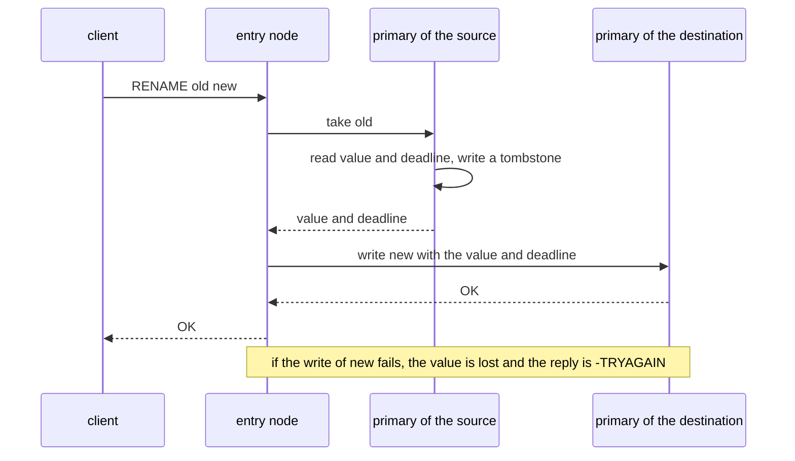

The redirect listener changes nothing for these keys. `READONLY` reads of a primary-read key go to
the primary, because `replica_reads` is false for it. The take and the put inside `RENAME` are
internal steps, so they forward and never return `-MOVED`. `COMMAND` reports the keys of `RENAME`
at positions 1, 2, and step 1.

`docs/cluster.md` describes how to run Authelia on Discus, with the timeouts that fit its client.
